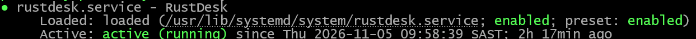

# RustDesk on Ubuntu – Installation & Configuration

Deployment of RustDesk on an Ubuntu VM, administered through SSH and connected to a self-hosted RustDesk server.

## Environment

| Component | Details |
|---|---|
| OS | Ubuntu |
| Architecture | x86_64 |
| RustDesk | 1.5.1 |
| Installation | Debian package |
| Display manager | LightDM |
| Service manager | systemd |
| Administration | SSH |

## Installation

Downloaded and installed the RustDesk Debian package:

```bash
wget https://github.com/rustdesk/rustdesk/releases/download/1.5.1/rustdesk-1.5.1-x86_64.deb
sudo apt install -y ./rustdesk-1.5.1-x86_64.deb
```

Verified the installation using `rustdesk --version`.

## Service Management

RustDesk runs as a systemd service.

Useful commands:

```bash
sudo systemctl status rustdesk
sudo systemctl restart rustdesk
sudo systemctl is-enabled rustdesk
```

### Service Status

The service is enabled and running.



## Server Configuration

The configuration files identified during deployment were:

- `/root/.config/rustdesk/RustDesk2.toml`
- `/var/lib/lightdm/.config/rustdesk/RustDesk2.toml`

Both files were updated with the self-hosted server address and public key.

Updating both configuration files resolved an issue where the VM appeared offline in the RustDesk client.

## Process Investigation

Process inspection using:

```bash
ps aux | grep -i rustdesk
```

showed the following execution contexts:

- `root` – RustDesk system service.
- `lightdm` – Graphical server and tray processes.

Understanding these processes helped identify the relevant configuration locations.

## Unattended Access

Configured unattended access using:

```bash
sudo rustdesk --password 'YOUR_STRONG_PASSWORD'
```

The password was successfully applied and remote connectivity was verified.

## Testing & Results

The following tests were successful:

- RustDesk connected to the self-hosted server.
- Ubuntu VM was accessible from another RustDesk client.
- Unattended access worked.
- RustDesk service restarted successfully.
- Remote access was restored after the service restart.

## Key Takeaways

Practical experience gained with:

- Linux package management and systemd.
- Process ownership and user contexts.
- Application configuration and persistence.
- Self-hosted remote-access infrastructure.
- Linux service troubleshooting.

## References

- [RustDesk Documentation](https://rustdesk.com/docs/)
- [RustDesk GitHub](https://github.com/rustdesk/rustdesk)

---

**Status:** Deployment completed and tested successfully.
